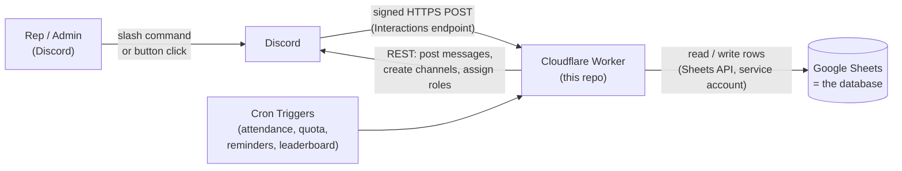

# Discord Sales CRM Bot

A serverless Discord bot that turns a Discord server into a lightweight CRM and
accountability system for an outbound sales team. Reps check in, log outreach,
and work their follow-up queue with slash commands and one-tap buttons. Managers
get attendance, quota and strike tracking, a weekly points leaderboard, and
hiring-cohort analytics. It runs on **Cloudflare Workers + Google Sheets for
$0/month**, with no server to keep alive.

> **About this project:** I designed the product and its rules, deployed it,
> and ran it with a live sales team. It was implemented with
> [Claude Code](https://claude.com/claude-code) (AI-assisted), and I iterated on
> it through real usage and bug reports. [`HOW_IT_WORKS.md`](./HOW_IT_WORKS.md)
> explains the design decisions and the problems solved along the way.

## What it does

**For reps**
- `/checkin`, `/standup`: daily attendance, plus a self-reported DM count for the leaderboard.
- `/excuse`: give a reason up front (sick, family event) and avoid a strike for that day.
- `/newprospect`, `/followup`: log outreach in a few keystrokes. Each new prospect schedules **3 follow-ups on a fixed cadence**.
- **Follow-up reminders with buttons.** The bot posts a reminder in each rep's *private* channel, and tapping *Replied / Seen, No Reply / No Response* logs it. No typing.
- `/myprospects`, `/leaderboard`, `/win`, `/help`.

**For managers**
- `/report`: attendance and activity per rep, including current-period strike counts.
- `/batches`: reps grouped into 2-month hiring cohorts, for tracking onboarding and attrition per cohort.
- `/handover`, `/handoverall`: reassign one prospect, or a departing rep's entire open pipeline.
- Automated flags when someone reaches the strike threshold. The bot **never takes disciplinary action itself**; it only notifies a human.

**Built-in guardrails**
- Re-contacting a prospect another rep already closed is refused automatically.
- 3 unexcused absences = 1 strike, and 4 under-quota days = 1 strike. Strikes count per 2-month calendar period and nothing is ever deleted, so there is a full audit trail.
- A private desk channel per rep, created on `/verify`. It mirrors that rep's activity and receives their personal nudges, and only that rep and admins can see it.

## Architecture



**The key design choice is that the bot never holds a connection open.**
Typical Discord bots keep a WebSocket (Gateway) connection alive, which needs an
always-on server, and most free hosts put idle processes to sleep or charge
for staying awake. This bot instead uses Discord's **HTTP Interactions** model:
Discord sends a signed request to the Worker each time someone uses a command,
and Cloudflare's own scheduler fires the periodic jobs. The result is
effectively free hosting with no uptime to babysit.

Google Sheets serves as the database. At this team's scale (tens of users) it
is more than fast enough, and it lets non-technical managers open, audit,
chart, or hand-correct the data without touching code.

## Tech stack

| Layer | Choice |
|---|---|
| Runtime | Cloudflare Workers (JavaScript, ES modules), Cron Triggers |
| Discord | HTTP Interactions API (slash commands, message components, ephemeral replies), REST API |
| Data | Google Sheets API v4, authenticated with a service-account JWT signed via Web Crypto |
| Tooling | Wrangler, `discord-interactions` (Ed25519 request verification) |
| Cost | $0/month on free tiers |

## How a command flows

1. A rep runs `/newprospect`. Discord POSTs a signed request to the Worker.
2. The Worker **verifies the Ed25519 signature**, rejecting anything not from Discord.
3. It replies within Discord's 3-second limit with a *deferred* acknowledgement, then does the real work in the background (`ctx.waitUntil`): validate, write to Sheets, post the rep's private card.
4. It edits the original reply with the result.

Details (cron scheduling, the data model, points and strike math, and the bugs hit
along the way) are in **[`HOW_IT_WORKS.md`](./HOW_IT_WORKS.md)**.

## Project layout

```
src/
  index.js            Worker entry: request verification, interaction routing, cron dispatch
  sheets.js           Google Sheets client (service-account JWT via Web Crypto, no Node deps)
  discordApi.js       Discord REST helpers (messages, roles, private channels)
  commands/           One handler per slash command, plus definitions.js (command schemas)
  prospects.js        Prospect lifecycle: create, follow-up cadence, close, reassign
  attendance.js       Check-in logic (present / excused / absent transitions)
  excuses.js          Excuse handling
  strikes.js          Absence + quota-miss tallying, strike conversion, threshold alerts
  leaderboard.js      Weekly points computation and table rendering
  followupButtons.js  One-tap follow-up logging via message components
  cron.js             Scheduled jobs (morning prompt, attendance sweep, quota sweep, ...)
  reportBuilder.js    Shared reporting logic
  reps.js, config.js, quotes.js   Helpers
scripts/register-commands.js      Pushes slash command definitions to Discord
```

## Getting started

You need a Discord application, a Google Cloud service account with the Sheets
API enabled, and a free Cloudflare account. Step-by-step instructions:

1. [`SHEET_SCHEMA.md`](./SHEET_SCHEMA.md): the spreadsheet tabs and columns to create
2. [`SERVER_SETUP.md`](./SERVER_SETUP.md): Discord channels, roles, permissions, rules template
3. [`DEPLOY.md`](./DEPLOY.md): configure, deploy, register commands, test

Configuration lives in `wrangler.toml`. IDs are blank in this repo, and
secrets (bot token, Google private key) are never stored in the repo.
Quotas, strike threshold, and follow-up cadence are plain config values.

## Limitations and next steps

- Google Sheets is a pragmatic database for small teams. At larger scale I'd move the hot path to Cloudflare D1 or KV and keep Sheets as a reporting export.
- No automated test suite yet. Core logic (points, strike conversion, date windows) is pure and straightforward to unit-test next.
- Schedule and timezone are fixed in `wrangler.toml` (UTC cron expressions) rather than configurable per team.
